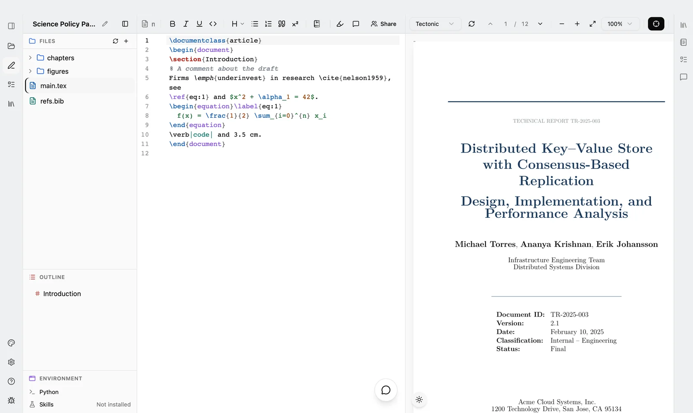
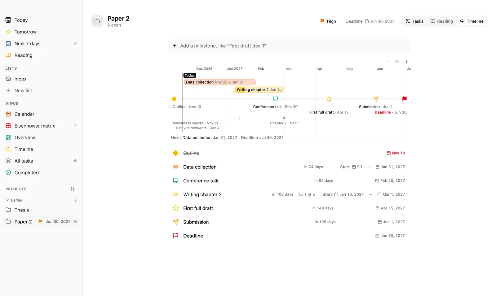
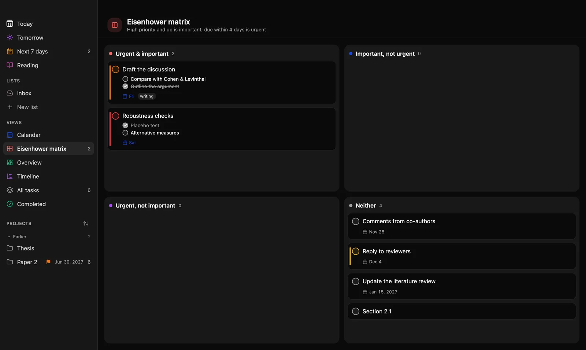
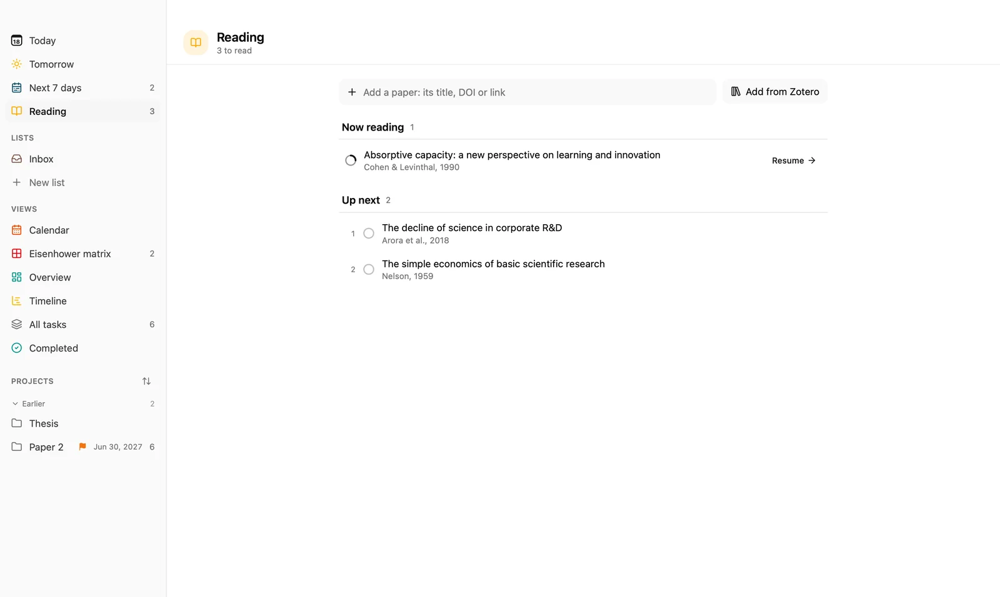
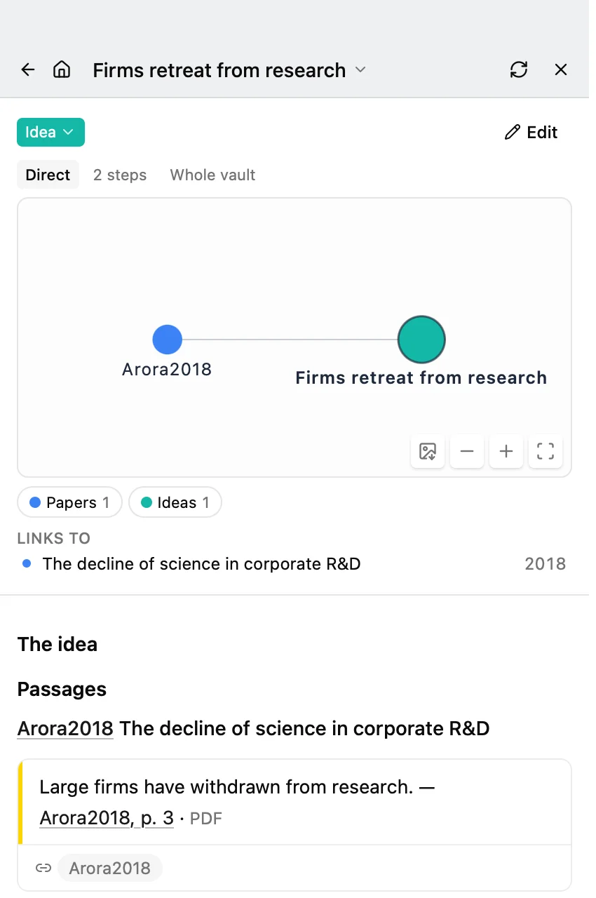
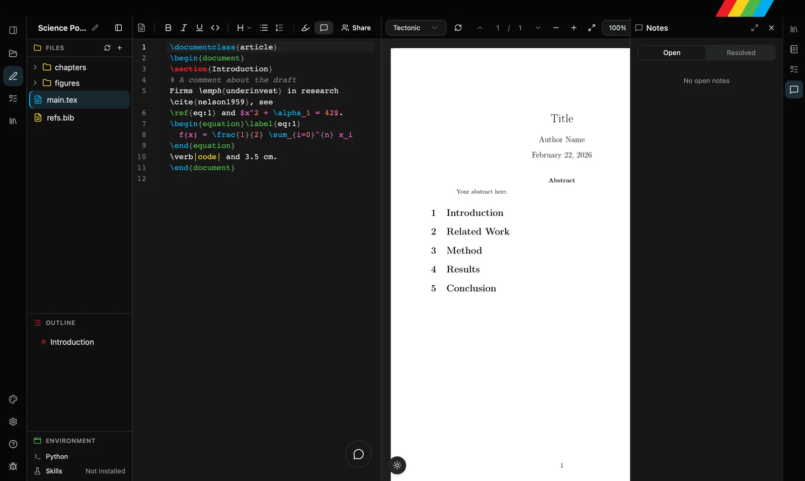

  

<h1 align="center">Latex4All</h1>

  A desktop LaTeX editor with Claude in it. 
  Your documents stay on your disk and compile locally.

> ### A fork of [Claude Prism](https://github.com/delibae/claude-prism)
>
> Latex4All is a personal fork of [delibae/claude-prism](https://github.com/delibae/claude-prism).
> Everything added on top of it, such as Zotero
> integration and one-click BibTeX capture, dictionary/thesaurus (WordNet) and
> grammar checking, LaTeX autocompletion, the Windows port, and the self-updating
> release/test channels was implemented by me through vibe-coding. As a disclaimer, i am not a programmer nor do i intend to pass as one, i just wanted to add features that i deeemed useful.
>
> **My involvement is direction, not authorship.** I decided what to build, made
> the design and architecture calls, tested it on real documents and hardware, and
> reviewed what came back — but I did not hand-write the implementation. Please
> judge the code on that basis, and prefer upstream if you want a project with
> conventional human authorship.

  

  &nbsp;
  

  &nbsp;
  

  The features below marked <b>new</b> are still in development: they're only in the test builds, 
  which carry every change as it lands and can have bugs. They'll come to a release once they're stable. 
  Linux and Intel macOS are no longer published — build from source if you need either.

---

## What it is

A desktop application for academic writing. You write LaTeX with the compiled
PDF beside it, with AI help in the editor, your Zotero library and your
Obsidian notes at hand, and a planner for your projects' tasks, deadlines and
reading. Projects can be shared with co-authors and edited together.

LaTeX compiles inside the app, so there is no TeX installation to maintain, and
every save is kept in a local history you can browse and roll back.

It also carries a Python environment and a large library of scientific skills
for Claude, both from upstream. [Claude Prism](https://github.com/delibae/claude-prism)
documents that side of it in full.

## What this fork adds

### Projects (new)

Your projects as cards or a list, sorted by when you opened them, their type or
their priority. Group them in folders (Thesis, Teaching…) by dragging them in or
from their right-click menu. Favourites stay at the top.

### Writing (new layout)

A menu on the left is there in every part of the app: Home, Writing, Planner,
Library & Vault, then Settings, Help and Report a bug. You can go anywhere and
come back to your project as you left it. The app also reopens where you left
off. Read the compiled PDF in the full window when you want to.

### Library and reading (new)

- **Zotero.** Browse your library, search it by title or author, insert
  citations, and add a single reference to a `.bib` file from its context menu.
- **A reader for papers.** Highlight in color and comment as you read; the
  comment box opens as soon as you highlight. Highlights on Zotero papers are
  saved in Zotero.
- **Your projects' PDFs** (drafts, exported papers) are in the Library too, and
  can be highlighted and commented the same way. When you rebuild a draft, the
  highlights follow their text.
- **Full-window reading,** with the paper zoomed to fit.

### Planner (new)

Each project's plan is a `Plan.md` file in its folder, written the way Obsidian
Tasks writes tasks, so Obsidian reads it too.

- **Task lists and boards,** with subtasks, priorities, due dates, repeating
  tasks and sections. Lists of your own (Teaching, Admin…) and an Inbox.
- **Today, Tomorrow, Next 7 days and a calendar** across every project.
- **An Eisenhower matrix** that sorts tasks by priority and date. You choose
  what counts as urgent and important, and can leave far-off goals out.
- **Timelines:** milestones with their own icons and colors, periods that fill
  as their tasks get done (and turn red when they fall behind), dragged along
  the line to reschedule. One timeline with every project, to see deadlines
  that clash.

  
  

### Reading lists (new)

Papers to read, for each project and in general: now reading, on hold, up next,
to re-read and finished. Each shows its authors, year and how far you've read,
and resumes where you stopped. An optional weekly reading goal.

### Notes, with Obsidian (new)

  
  

Your Obsidian vault (a folder, or a WebDAV server) inside the app. Papers get
notes of their own with your highlights. Topics and ideas collect passages
word for word from papers, from your PDFs and from your own writing, each with
a link back to where it came from. Connect notes however you like and see them
on a map.

### Shared projects

Share a project with co-authors through an encrypted relay. Everyone edits the
same files at once, with comments and suggestions.

### Writing aids

- **Dictionary, thesaurus and spell checking.** Right-click a word for its
  definition, synonyms and antonyms. Grammar checking runs locally rather than
  through a service. English and Spanish.
- **LaTeX autocompletion,** and a reference panel for the commands nobody
  remembers.

### Look

Themes in light, dark, colorful and retro styles (and one of your own), a
gradient background, and an interface size of your choosing.

### Windows and updates

The spelling, thesaurus and grammar services were ported, and CI builds Windows
installers alongside macOS. Updates come inside the app, from two channels:
releases, and a test channel that publishes every change as it lands. You can
move between them in either direction, and each update shows what changed.

## Data and privacy

Your documents are stored and compiled on your own machine. Nothing is uploaded
for storage. Shared projects travel between co-authors through a relay, encrypted
on your computer before they leave it; the relay can't read them.

The AI features are not local. When Claude reads or edits a file, that content
is sent to Anthropic's API, as with any hosted model. See
[Claude Code data usage](https://code.claude.com/docs/en/data-usage) for
retention and opt-out.

## Installing

Download a build from [Releases](https://github.com/Alejandro-Raga/Latex4all/releases),
or build from source — see [CONTRIBUTING.md](./CONTRIBUTING.md).

macOS builds are ad-hoc signed rather than notarised, because the project has no
Apple Developer account.

## Contributing

[CONTRIBUTING.md](./CONTRIBUTING.md) covers development setup and testing.

## Acknowledgments

Built on [Claude Prism](https://github.com/delibae/claude-prism), which in turn
started from [Open Prism](https://github.com/assistant-ui/open-prism) by
[assistant-ui](https://github.com/assistant-ui).

## License

[MIT](./LICENSE)
